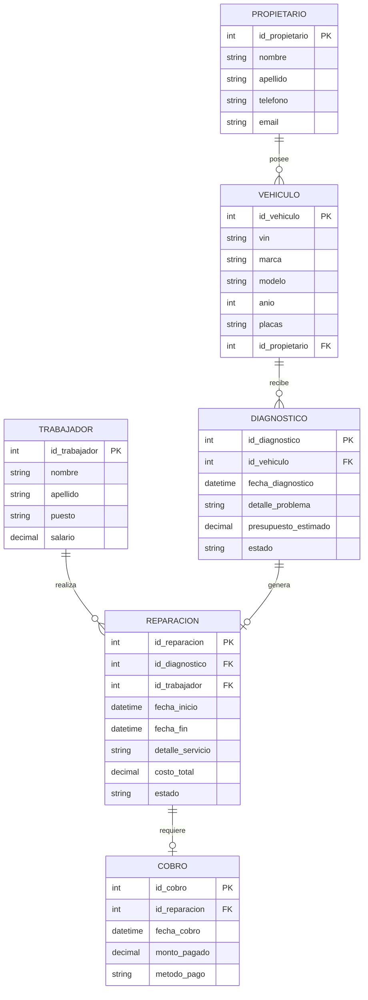

# Reporte de Base de Datos: Sistema de Gestión de Taller Automotriz

**Materia:** Bases de Datos  
**Repositorio:** GitHub (Isaac Daniel Barrera Canales 6to Semestre Grupo 2)  
**Formato:** Markdown (`README.md` / Documentación Digital/ Base de Datos Taller Mecanico)  
**Estructura del Reporte:** IDC (Introducción, Desarrollo, Conclusión)

---

## 1. INTRODUCCIÓN

El presente reporte digital documenta el diseño, normalización e implementación del sistema de base de datos relacional para la gestión operativa de un **Taller de Reparación Automotriz**, estructurado bajo el formato **IDC (Introducción, Desarrollo y Conclusión)**.

### Modelo Relacional y Normalización
Para garantizar la integridad de la información y eliminar redundancias en el almacenamiento de datos, el sistema implementa un **Modelo Relacional** desarrollado a través de las etapas del proceso de **Normalización**:

* **1ra Forma Normal (1FN):** Eliminación de atributos multivaluados y grupos repetitivos, garantizando que cada celda de la tabla contenga valores atómicos (indivisibles).
* **2da Forma Normal (2FN):** Eliminación de dependencias parciales. Se asegura que todos los atributos que no forman parte de la clave primaria dependan de la clave primaria completa de manera directa.
* **3ra Forma Normal (3FN):** Eliminación de dependencias transitivas. Ningún atributo no clave depende de otro atributo no clave; todas las columnas no clave dependen exclusivamente de la clave primaria.

---

## 2. DESARROLLO

En esta sección se detalla la metodología de diseño relacional, la estructura DDL de la base de datos, las manipulaciones DML (inserciones) y la resolución de las consultas operativas clave.

### 2.1 Metodología de Diseño
1. **Entidad:** Identificación de las entidades principales del dominio: `Propietario`, `Vehiculo`, `Trabajador`, `Diagnostico`, `Reparacion` y `Cobro`.
2. **Relaciones:** Definición de la interacción entre tablas mediante claves primarias (`PK`) y claves foráneas (`FK`).
3. **Cardinalidad (MER):**
   * Un **Propietario** posee de `1:N` **Vehículos**.
   * Un **Vehículo** recibe de `1:N` **Diagnósticos**.
   * Un **Trabajador** realiza de `1:N` **Reparaciones**.
   * Un **Diagnóstico** genera `1:1` **Reparación**.
   * Una **Reparación** requiere `1:1` **Cobro**.
4. **PKs y MR (Modelo Relacional):** Definición formal de claves primarias simples autonumerables y esquema de relaciones entre tablas.

---

### 2.2 Modelo Relacional (Diagrama ER)



---

### 2.3 Bloque SQL DDL (Data Definition Language)

```sql
-- Creación de la Base de Datos
CREATE DATABASE IF NOT EXISTS taller_automotriz;
USE taller_automotriz;

-- Tabla: PROPIETARIO
CREATE TABLE propietario (
    id_propietario INT AUTO_INCREMENT PRIMARY KEY,
    nombre VARCHAR(50) NOT NULL,
    apellido VARCHAR(50) NOT NULL,
    telefono VARCHAR(15),
    email VARCHAR(100) UNIQUE
) ENGINE=InnoDB;

-- Tabla: VEHICULO
CREATE TABLE vehiculo (
    id_vehiculo INT AUTO_INCREMENT PRIMARY KEY,
    vin VARCHAR(17) UNIQUE NOT NULL,
    marca VARCHAR(30) NOT NULL,
    modelo VARCHAR(30) NOT NULL,
    anio INT NOT NULL,
    placas VARCHAR(10) UNIQUE NOT NULL,
    id_propietario INT NOT NULL,
    CONSTRAINT fk_vehiculo_propietario 
        FOREIGN KEY (id_propietario) REFERENCES propietario(id_propietario)
        ON DELETE RESTRICT ON UPDATE CASCADE
) ENGINE=InnoDB;

-- Tabla: TRABAJADOR
CREATE TABLE trabajador (
    id_trabajador INT AUTO_INCREMENT PRIMARY KEY,
    nombre VARCHAR(50) NOT NULL,
    apellido VARCHAR(50) NOT NULL,
    puesto VARCHAR(30) DEFAULT 'Mecánico',
    salario DECIMAL(10,2) NOT NULL
) ENGINE=InnoDB;

-- Tabla: DIAGNOSTICO
CREATE TABLE diagnostico (
    id_diagnostico INT AUTO_INCREMENT PRIMARY KEY,
    id_vehiculo INT NOT NULL,
    fecha_diagnostico DATETIME NOT NULL,
    detalle_problema TEXT NOT NULL,
    presupuesto_estimado DECIMAL(10,2) NOT NULL,
    estado ENUM('Pendiente', 'Aprobado', 'Rechazado') DEFAULT 'Pendiente',
    CONSTRAINT fk_diagnostico_vehiculo 
        FOREIGN KEY (id_vehiculo) REFERENCES vehiculo(id_vehiculo)
        ON DELETE RESTRICT ON UPDATE CASCADE
) ENGINE=InnoDB;

-- Tabla: REPARACION
CREATE TABLE reparacion (
    id_reparacion INT AUTO_INCREMENT PRIMARY KEY,
    id_diagnostico INT UNIQUE NOT NULL,
    id_trabajador INT NOT NULL,
    fecha_inicio DATETIME NOT NULL,
    fecha_fin DATETIME NULL,
    detalle_servicio TEXT NOT NULL,
    costo_total DECIMAL(10,2) NOT NULL,
    estado ENUM('En Proceso', 'Reparado', 'Entregado') DEFAULT 'En Proceso',
    CONSTRAINT fk_reparacion_diagnostico 
        FOREIGN KEY (id_diagnostico) REFERENCES diagnostico(id_diagnostico)
        ON DELETE RESTRICT ON UPDATE CASCADE,
    CONSTRAINT fk_reparacion_trabajador 
        FOREIGN KEY (id_trabajador) REFERENCES trabajador(id_trabajador)
        ON DELETE RESTRICT ON UPDATE CASCADE
) ENGINE=InnoDB;

-- Tabla: COBRO
CREATE TABLE cobro (
    id_cobro INT AUTO_INCREMENT PRIMARY KEY,
    id_reparacion INT UNIQUE NOT NULL,
    fecha_cobro DATETIME NOT NULL,
    monto_pagado DECIMAL(10,2) NOT NULL,
    metodo_pago ENUM('Efectivo', 'Tarjeta', 'Transferencia') NOT NULL,
    CONSTRAINT fk_cobro_reparacion 
        FOREIGN KEY (id_reparacion) REFERENCES reparacion(id_reparacion)
        ON DELETE RESTRICT ON UPDATE CASCADE
) ENGINE=InnoDB;
```

---

### 2.4 Bloque SQL DML (Data Manipulation Language)

#### Inserción de Datos (`INSERT`)

```sql
-- Inserción de Propietarios
INSERT INTO propietario (nombre, apellido, telefono, email) VALUES
('Carlos', 'Mendoza', '7751234567', 'carlos.mendoza@email.com'),
('Ana', 'García', '7759876543', 'ana.garcia@email.com'),
('Luis', 'Hernández', '7755554433', 'luis.hernandez@email.com');

-- Inserción de Vehículos
INSERT INTO vehiculo (vin, marca, modelo, anio, placas, id_propietario) VALUES
('1HGCR2F83HA000001', 'Honda', 'Civic', 2018, 'HDK-123-A', 1),
('3FA6P0H72HR000002', 'Ford', 'Fusion', 2019, 'HDK-456-B', 2),
('1G1AL52F877000003', 'Chevrolet', 'Aveo', 2020, 'HDK-789-C', 3);

-- Inserción de Trabajadores (Mecánicos)
INSERT INTO trabajador (nombre, apellido, puesto, salario) VALUES
('Roberto', 'Sánchez', 'Mecánico General', 12000.00),
('Miguel', 'López', 'Especialista Eléctrico', 13500.00),
('Jorge', 'Gómez', 'Mecánico Diagnostizador', 12500.00);

-- Inserción de Diagnósticos
INSERT INTO diagnostico (id_vehiculo, fecha_diagnostico, detalle_problema, presupuesto_estimado, estado) VALUES
(1, '2026-09-01 09:00:00', 'Falla en sistema de frenos y afinación', 3500.00, 'Aprobado'),
(2, '2026-09-03 10:30:00', 'Cambio de embrague y suspensión', 6800.00, 'Aprobado'),
(3, '2026-09-07 08:15:00', 'Fallo de alternador y batería', 2900.00, 'Aprobado');

-- Inserción de Reparaciones
INSERT INTO reparacion (id_diagnostico, id_trabajador, fecha_inicio, fecha_fin, detalle_servicio, costo_total, estado) VALUES
(1, 1, '2026-09-01 10:00:00', '2026-09-03 16:00:00', 'Se rectificaron discos y cambio de balatas', 3500.00, 'Entregado'),
(2, 1, '2026-09-03 11:00:00', '2026-09-05 14:00:00', 'Reemplazo completo del kit de embrague', 6800.00, 'Reparado'),
(3, 2, '2026-09-07 09:00:00', '2026-09-07 11:30:00', 'Reemplazo de alternador nuevo', 2900.00, 'Entregado');

-- Inserción de Cobros
INSERT INTO cobro (id_reparacion, fecha_cobro, monto_pagado, metodo_pago) VALUES
(1, '2026-09-03 16:30:00', 3500.00, 'Efectivo'),
(2, '2026-09-06 11:00:00', 6800.00, 'Transferencia'),
(3, '2026-09-07 12:00:00', 2900.00, 'Tarjeta');
```

---

#### Consultas de Respuesta a Negocio (`SELECT`)

**1. ¿Cuántos autos reparamos la primera semana de septiembre?**

```sql
SELECT COUNT(*) AS total_autos_reparados_1ra_semana
FROM reparacion
WHERE estado IN ('Reparado', 'Entregado')
  AND fecha_fin >= '2026-09-01 00:00:00' 
  AND fecha_fin <= '2026-09-07 23:59:59';
```

---

**2. ¿Cuánto $ ingresó el día de hoy?**

```sql
SELECT 
    COALESCE(SUM(monto_pagado), 0.00) AS ingreso_total_hoy
FROM cobro
WHERE DATE(fecha_cobro) = CURDATE();
```

---

**3. ¿Quién es el trabajador con más autos reparados en el mes?**

```sql
SELECT 
    t.id_trabajador,
    t.nombre,
    t.apellido,
    COUNT(r.id_reparacion) AS total_autos_reparados
FROM trabajador t
JOIN reparacion r ON t.id_trabajador = r.id_trabajador
WHERE r.estado IN ('Reparado', 'Entregado')
  AND MONTH(r.fecha_fin) = MONTH(CURDATE())
  AND YEAR(r.fecha_fin) = YEAR(CURDATE())
GROUP BY t.id_trabajador, t.nombre, t.apellido
ORDER BY total_autos_reparados DESC
LIMIT 1;
```

---

## 3. CONCLUSIÓN

El diseño de la base de datos para el taller automotriz cumple cabalmente con la estructura **IDC** requerida:

1. **Eficiencia por Normalización:** La inclusión de las tres formas normales en la fase inicial eliminó datos duplicados, redujo espacio de almacenamiento y previno inconsistencias operativas.
2. **Integridad Relacional:** Las metodologías aplicadas (Entidad, Relaciones, Cardinalidad MER, PKs y MR) garantizan relaciones de datos sólidas y protegidas mediante llaves foráneas.
3. **Consistencia Transaccional:** La combinación de DDL y DML responde de manera inmediata y precisa a las tres consultas clave de negocio planteadas por la dirección.
